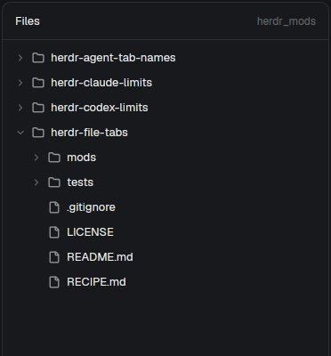

# File tabs

Herdr's Files panel, except a click on a file opens it in a terminal app that handles its type, such as micro or vim, in a new tab in the main area; only when no terminal app can, in its default desktop app (Gwenview, a browser) in its own window. This is a piece you put in your current layout in place of the shipped `files` mod, not a whole window. Linux only.

This file is the brief: enough to build File tabs from an empty folder. The files next to it are one build of it. If they don't work on your Herdr, or you want it different, build it again from here.

## What you see

- The panel looks like the shipped Files panel: a 42px header with "Files" (semibold) on the left and the current folder's name (12px, `dim`) on the right, then the tree. Rows are 28px, indented 18px per level, with a 12px chevron for folders, a 14px folder or file icon (`muted`), the name (13px, truncated) and a git mark on the right (11px: `A` in `ansi2`, `D`/`U` in `ansi1`, `M` in `blocked`). Rows highlight with `hover`. The panel has a 10px radius, a 1px `border` and the theme `background`. There is no back arrow and no preview inside the panel.
- A file opened in a terminal app gets a tab named after its path relative to the tree's folder (`src/main.py`), a terminal running the app on the file.
- Failures show an error toast titled "Can't open <path>".

## How it behaves

- The tree follows the focused terminal's live folder, as the shipped panel does: lazy folders, 500 entries per folder and 5,000 in total, `.git` hidden, git marks from `git status`, refreshed by a folder watch (local only) and every 10 seconds, expanded folders remembered per folder.
- Clicking a folder expands or collapses it. Clicking a file:
  1. If the space has a tab with that exact name whose terminal runs something other than a shell and is still in the tree's folder, that tab is selected. The folder check keeps `README.md` from another project's tree from selecting this one's tab.
  2. Otherwise a terminal app is looked for on the file's machine. Type: `xdg-mime query filetype`. Candidates, in order: `xdg-mime query default <type>`, then the apps `LC_ALL=C gio mime <type>` prints (its default, registered and recommended lists, which include apps of parent types); if there are none and the type is `text/*`, the same for `text/plain`. Each candidate's desktop file is the first found in `$XDG_DATA_HOME/applications` and each `$XDG_DATA_DIRS/applications`; the first whose `[Desktop Entry]` section has `Terminal=true` and an `Exec=` wins.
  3. Found: a new tab in the shown space, started in the tree's folder (so the tree stays put), running the `Exec` line with the file in place of `%f`/`%F`/`%u`/`%U` (appended when there is none), `%i`/`%c`/`%k` dropped and `%%` as `%`, double quotes and backslash escapes honoured.
  4. None, on this computer: `setsid -f xdg-open <file>`, so the default desktop app gets its own window and outlives the call.
  5. None, in a space on another machine: an error toast, "No terminal app for it on <machine>".
- When the app quits, its tab is left with a shell (Herdr runs `argv` in the interactive shell); the next click on that file opens a new tab.

## Built from

- **One mod**, `mods/files-tabs/`, with `main.js`, `match.js`, `mod.json` (`{ "place": "none" }`) and the shipped Files icons `chevron-down.svg`, `chevron-right.svg`, `file.svg`, `folder.svg`, referenced as `mods/files-tabs/<icon>.svg`. No `layouts/` folder: the person changes the Files block of their own layout to `{ "mod": "files-tabs" }`; the shipped `main` layout is read-only, so they clone it first (`layout.clone`).
- **Tree:** the shipped `files` mod's code with its preview removed: `exec("sh", …)` (PowerShell on Windows) to list a folder, `exec("git", …)` for marks, `watchFolder`, `spaces()`, `panes()`, `focused()`, `theme()`.
- **Opening:** one `sh -c` script through `exec(…, { on })` prints the chosen terminal app's desktop id, `true` and its `Exec=` line (`awk` over each desktop file), or nothing. Then `run("tab.new", { name, space, folder, argv })`, or `exec("setsid", ["-f", "xdg-open", file])`. Reuse: `fileTab(space, panes(), path, root)` in `match.js`, a pure function (`spaces()` tabs with `named && name === path`, and `panes()` with that `tab`, a `terminal`, `!program.shell` and `cwd === root`), then `run("tab.select", { id })`. `tests/match.test.mjs` covers it with `node --test tests/`. Errors: `notify({ title, body, level: "error" })`.

## Watch out

- The default app alone isn't enough: on KDE most text types default to Kate, while micro or vim are registered for them too. `xdg-mime query default` returns nothing for some types (`text/javascript`); `gio mime` lists apps there, including those of parent types. `text/x-rust` has no apps at all; hence the `text/plain` fallback.
- Write the script without `${…}` if it lives in a JS template literal (`String.raw` still interpolates it).
- `gio mime` output is localized; run it with `LC_ALL=C`.
- Don't `exec("xdg-open")` without `setsid -f`: some apps keep it waiting until they exit, and `exec` times out after 30 s.
- `console.log` treats `%f`/`%i` as format codes; don't test the Exec parser through it.
- Vendor-prefixed desktop ids that map to subfolders (`kde-foo.desktop` → `kde/foo.desktop`) aren't resolved; those files go to `xdg-open`.
- Herdr's shipped `files` mod is read-only; copy its code, never edit it. Follow the installed `herdr.d.ts` and `gpui-kit.d.ts`.
- The mod runs `sh`, `git`, `xdg-mime`, `gio`, `awk`, `setsid`, `xdg-open` and the default apps themselves, and on Windows `powershell` for listing.

## Done when

- `herdr-app check mods/files-tabs` passes with the matching Herdr binary and home.
- With the layout's Files block set to `files-tabs`, the Files button shows the tree for the focused terminal's folder, with git marks.
- With micro installed, `.py`, `.md`, `.json`, `.js` and `.rs` files open in micro in a tab named after their relative path, in the tree's folder, even where Kate is the default; clicking one again selects that tab.
- A type whose default is a terminal app opens in that app (`.sh` → vim when vim is the default).
- A `.png` or `.pdf` opens in its default desktop app's window and adds no tab.
- After quitting the terminal app, clicking the file opens a new tab.
